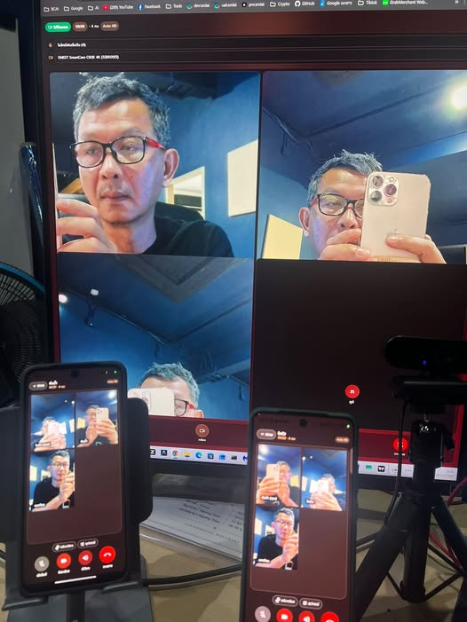
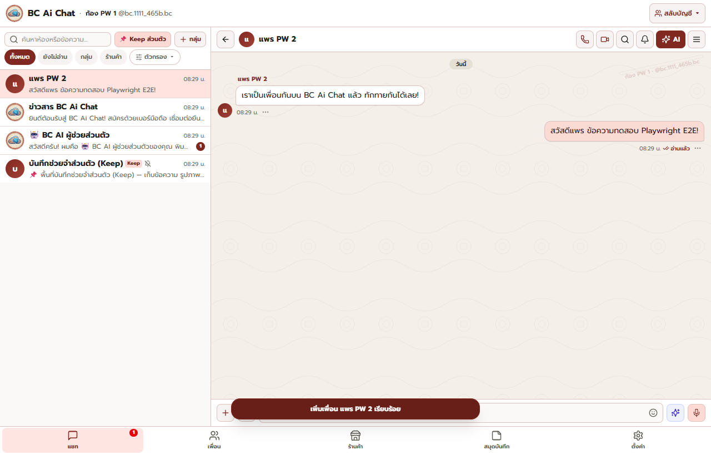
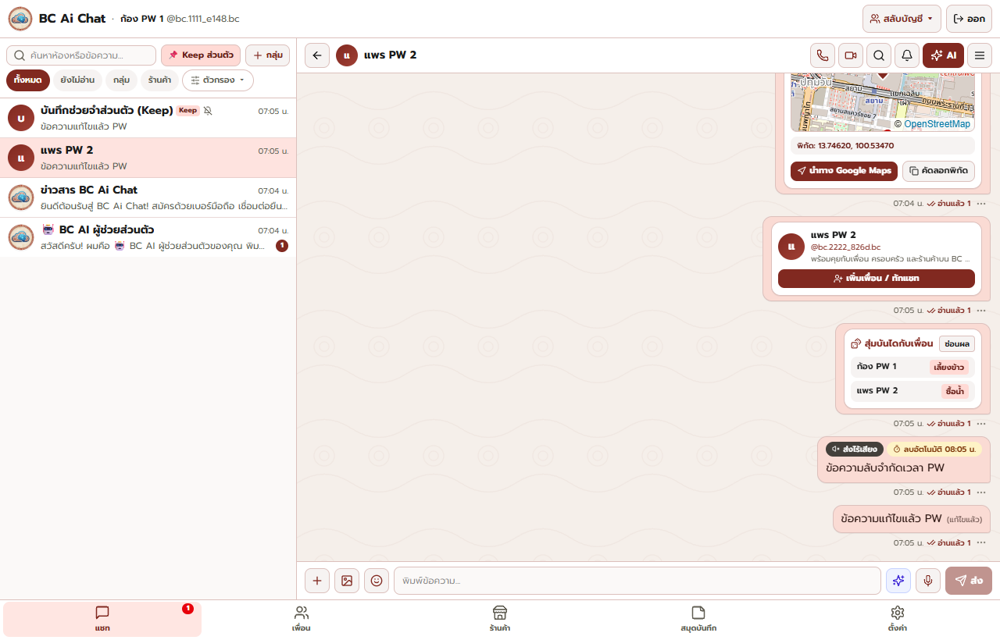
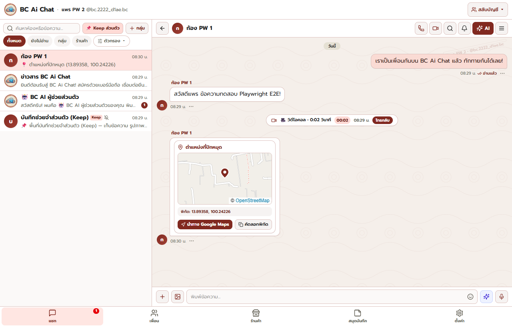
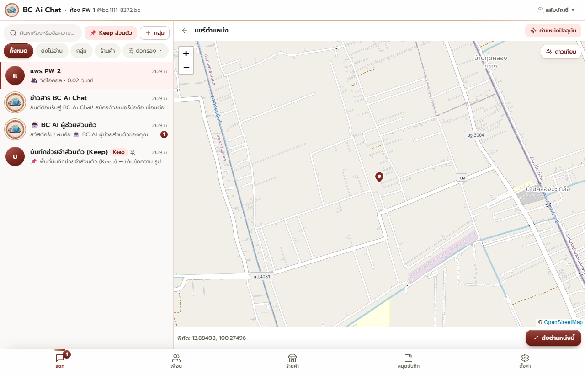
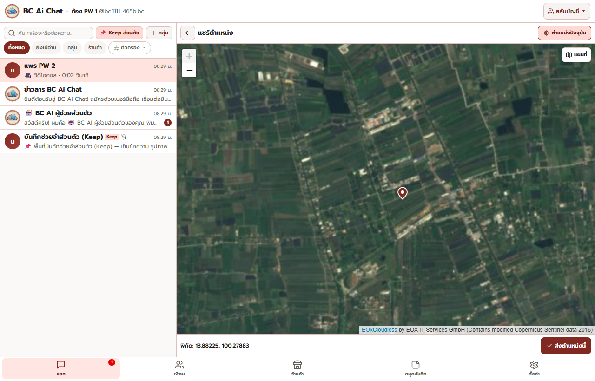
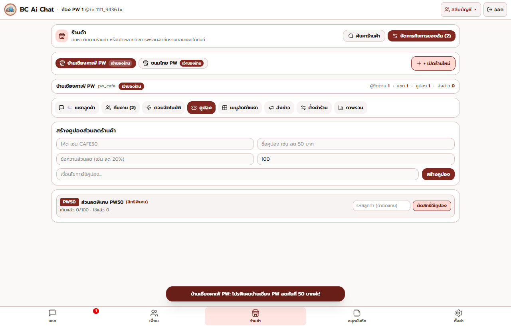
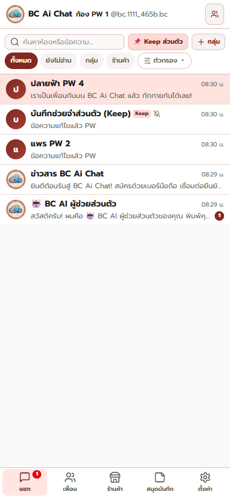
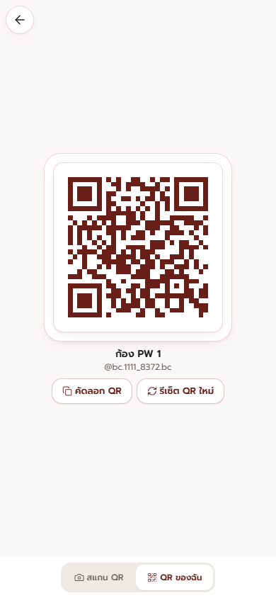
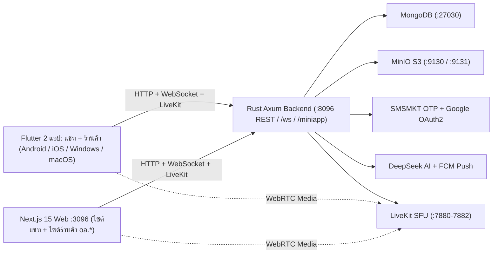

# BC Ai Chat

แอปแชทส่วนตัว ครอบครัว และแก๊งเพื่อนภาษาไทย พร้อมผู้ช่วย AI (`DeepSeek`), คลังรูปภาพและไฟล์ถาวร (`MinIO`), การโทรด้วยเสียงและวิดีโอ (`LiveKit SFU`), บัญชีทางการร้านค้าและทีมแอดมิน (`BC Ai Chat OA`), และห้องแชทข้ามแพลตฟอร์ม (`Web`, `Android`, `iOS`, `Windows`, `macOS`) แบบ **Mobile-First ไร้ Popup รบกวน** บนอัตลักษณ์ศิลปะร่วมสมัย **ธีมดินเผาบ้านเชียง (`ban_chiang`)** ปลอดลิขสิทธิ์ 100%

---

## ภาพตัวอย่าง

**วิดีโอคอลกลุ่มบนอุปกรณ์จริงพร้อมกัน** — เว็บบนจอใหญ่ + แอป Android 2 เครื่อง



**จอกว้าง: รายการแชทซ้าย + ห้องแชทขวา**



**ข้อความครบเครื่อง: ตำแหน่งที่ตั้ง, แนะนำเพื่อน, สุ่มบันได, ข้อความเงียบ/หมดอายุ, บันทึกการโทร**



**แผนที่ฟรี (OpenStreetMap): แผนที่ในการ์ดตำแหน่ง และเลือกตำแหน่งบนแผนที่แบบเต็มพื้นที่**







**BC Ai Chat OA: หลายร้านค้า ทีมงาน ลูกค้า และคูปอง (ไซต์ร้านค้า `oa.<โดเมน>`)**



**มือถือ: รายการแชท และ QR ของฉันแบบเต็มจอ**

<p>
  
  
</p>

> ภาพหน้าจอ (ยกเว้นภาพถ่ายอุปกรณ์จริง) สร้างจากชุดทดสอบจริง: `README_SHOTS_DIR=docs/screenshots node e2e/e2e_playwright_web_5users.mjs`

---

## Objective

**BC Ai Chat** พัฒนาขึ้นเพื่อเป็นพื้นที่สื่อสารส่วนตัวที่ปลอดภัย ใช้งานง่าย และครบครันสำหรับครอบครัว แก๊งเพื่อน และร้านค้ารายย่อย โดยผสานการยืนยันตัวตนด้วย **เบอร์โทรศัพท์ OTP (SMSMKT)** และ **Google OAuth2**, ระบบ **กู้คืนบัญชีด้วยตนเอง (PIN 6 หลัก + รหัสสำรองใช้ครั้งเดียว)**, การโทรเสียง/วิดีโอผ่าน **LiveKit**, บัญชีร้านค้า **BC Ai Chat OA** แบบหลายร้านและแบ่งสิทธิ์ทีม, สมุดบันทึกส่วนตัว **Keep**, และผู้ช่วย **DeepSeek AI** ภายใต้การออกแบบ **Mobile-First 4 แท็บ** ที่ใช้ Inline Trays/Panels โดยไม่เปิด Popup ซ้อนหน้าจอ

- **7 ธีมสีไทยร่วมสมัย + 3 โทนห้องแชท**: ค่าเริ่มต้น **บ้านเชียง (`ban_chiang`: `#812920` / `#FBF9F8`)** พร้อมชุดสี **ไหมทองอำพัน (`silk_amber`)**, **ครามสุโขทัย (`indigo_kram`)**, **หยกสังคโลก (`jade_celadon`)**, **บัวหลวงชมพู (`lotus_rose`)**, **อบเชยเครื่องเทศ (`spice_cinnamon`)**, และ **มณีม่วงไทย (`royal_amethyst`)** รวมถึง 3 โทนห้องแชท (`ban_chiang_cream` `#F5EFEA`, `terracotta_night` `#1C1412`, `ivory_white` `#FBF9F8`) ซิงค์สดข้ามหน้าจอผ่าน WebSocket (`theme_changed`)
- **แยก 2 แอป หลังบ้านตัวเดียว**: **BC Ai Chat** สำหรับคนทั่วไป (ไม่มีเมนูจัดการกิจการ มีเพียงค้นหา/ติดตามร้าน ห้องแชทกับร้าน และคูปอง) และ **BC Ai Chat OA** สำหรับร้านค้า (จัดการร้าน ทีม กล่องแชทลูกค้า ลูกค้า (CRM) คูปอง ส่งข่าว) ทั้งบนเว็บ (2 ไซต์แยกตามโฮสต์) และบนมือถือ (2 แอป 2 ไอคอน) ใช้บัญชีเดียวกันและ Backend/ฐานข้อมูลชุดเดียวกัน
- **นโยบายทรัพย์สินทางปัญญาปลอดลิขสิทธิ์ 100%**: ใช้แบรนด์ **BC Ai Chat**, **BC Ai Chat OA**, **สมุดบันทึก BC**, **Keep ส่วนตัว**, **การ์ดโต้ตอบ (`rich_card`)**, และชุดสติกเกอร์ข้อความต้นฉบับ (*"อารมณ์ดีดินเผาไทย"*) พร้อมลวดลายเส้นเกลียวคลื่นประยุกต์ CSS/SVG ต้นฉบับ ฟอนต์ `Prompt` (**SIL OFL**), ไอคอน `lucide-react` (**MIT**) / Material Icons (**Apache-2.0**) และเสียงแจ้งเตือน WAV สังเคราะห์ในโปรเจกต์

---

## Workflow



1. **ยืนยันตัวตน, เจ้าของระบบเริ่มต้น และการกู้คืนบัญชี**:
   - **Phone OTP (SMSMKT)** และ **Verified Google OAuth2**: ผู้ใช้เข้าสู่ระบบหรือลงทะเบียนใหม่ด้วยเบอร์โทรศัพท์ไทย (รับรหัสอ้างอิง `ref_code` และคูลดาวน์ 60 วินาที) หรือบัญชี Google ที่ตรวจสอบ `aud` และ `email_verified` จากปลายทาง Google
   - **Owner Bootstrap Admin**: เจ้าของระบบคนแรกสามารถตั้งค่าบัญชีผู้ดูแลหลักผ่าน `POST /api/auth/bootstrap-admin` ด้วยรหัส `ADMIN_BOOTSTRAP_CODE` จาก `.env` เมื่อยังไม่มีผู้ดูแลในระบบ ส่วนผู้ใช้ที่สมัครตามหลังจะได้รับสิทธิ์ `user` โดยอัตโนมัติ
   - **เชื่อมโยงบัญชีและกู้คืนด้วยตนเอง**: ผูก/ถอด Gmail และเบอร์ OTP ตั้ง **PIN 6 หลัก** พร้อมรับ **รหัสสำรอง 6 ชุด** (`BCRC-XXXX-XXXX` ใช้ได้รหัสละ 1 ครั้ง) สำหรับเปลี่ยนเบอร์หรือเปลี่ยน Gmail เอง (มีล็อกเมื่อใส่ผิดครบ 5 ครั้ง และเพิกถอนเซสชันเดิมทุกอุปกรณ์แบบ O(1) ผ่าน `token_versions`)

2. **Mobile-First 4 แท็บหลัก & UX แบบไร้ Popup**:
   - แถบนำทางหลัก 4 แท็บ: **เพื่อน/หน้าหลัก** (`0`), **แชท** (`1` — ค่าเริ่มต้น), **สมุดบันทึก** (`2`), และ **ตั้งค่า** (`3`) พร้อมแถบโฟลเดอร์ 7 หมวดแบบตัดบรรทัด ไม่เลื่อนซ้าย-ขวา (`ทั้งหมด`, `ส่วนตัว`, `ครอบครัว`, `กลุ่ม`, `ปักหมุด`, `ยังไม่อ่าน`, `เก็บถาวร`)
   - บนหน้าจอมือถือ (`< md`) เข้าห้องแชทแบบเต็มจออัตโนมัติ และควบคุมเครื่องมือผ่าน Inline Trays/Panels ทั้งบน Web และ Flutter โดยไม่มี Popup (`[role="dialog"]`, `.fixed.inset-0`, `showDialog`, `showModalBottomSheet`)
   - **ปรับตามขนาดจออัตโนมัติ**: ปุ่ม **แชท** อยู่ลำดับแรกของแถบนำทาง; จอกว้าง (Web `>= 768px`, Flutter `>= 840px`) แสดงเต็มจอแบบสองฝั่ง — รายการ 380px ทางซ้ายและห้องแชททางขวา (Flutter ใช้ `NavigationRail` แทนแท็บล่าง) ส่วนจอแคบคงรูปแบบมือถือเดิม

3. **เพิ่มเพื่อน 4 ช่องทาง, ความเป็นส่วนตัว, ปิดเสียง และแชทครบเครื่อง**:
   - เพิ่มเพื่อนด้วย **QR Code**, **เบอร์โทร**, **`@bc_id`**, หรือ **Email** โดยระบบเคารพสวิตช์ความเป็นส่วนตัวรายช่องทาง (`allow_add_by_phone`, `allow_add_by_id`, `allow_add_by_email`), รองรับ **Reset QR Token**, **ลบเพื่อน**, **ปิดเสียงรายห้องแบบตั้งเวลา** (`1 ชม.`, `8 ชม.`, `ถึง 08:00 น.`, `ตลอดไป`), **DND ทั้งระบบ**, และ **Silent Block** ที่ซ่อนข้อความ/สายโทรจากผู้ถูกบล็อกโดยอีกฝ่ายไม่รู้ตัว
   - **สแกน QR เต็มจอ**: ปุ่ม "สแกน QR เต็มจอ" ในแผงเพิ่มเพื่อนเปิดหน้าเต็มจอที่สลับ **สแกน QR / QR ของฉัน** ได้ (Web: `MainShell.tsx` + `BarcodeDetector` และอัปโหลดรูป QR, Flutter: `lib/screens/qr_friend_screen.dart` + `mobile_scanner`)
   - ภายในห้องแชทรองรับข้อความ **แก้ไขสด** (`PUT /api/messages/:id` + WS `message_edited`), **ส่งต่อหลายห้อง**, **ส่งตำแหน่งที่ตั้ง (`location_data`)** พร้อมแผนที่ฟรี OpenStreetMap ในการ์ด โดยกดปุ่ม "ตำแหน่ง" แล้วเข้าหน้าแผนที่เต็มจอทันที (แตะแผนที่เพื่อย้ายหมุดแบบ animation, กดที่หมุดแล้วลากได้โดยแผนที่เลื่อนตามเองเมื่อถึงขอบ, ปุ่มสลับ "ดาวเทียม/แผนที่", ปุ่มจับตำแหน่งปัจจุบันจาก GPS แล้วกด "ส่งตำแหน่งนี้"), **การ์ดแนะนำเพื่อน (`contact_data`)**, **เกมสุ่มบันได (`ladder_data`)**, **ส่งแบบเงียบ & ข้อความลบอัตโนมัติ**, **สมุดบันทึก Keep ส่วนตัว**, ปรับสปีดเสียง `1x / 1.5x / 2x`, อัลบั้ม, โพล, นัดหมาย, ข้อความลับ PIN, Mini-Apps ส่วนตัว 5 ตัว, และผู้ช่วย `@ai`
   - **ขั้นตอนใช้งานแบบที่คุ้นมือ (Web + Flutter)**: ปุ่ม `+` ในห้องแชทเปิดเมนูไอคอนล้วน (ตำแหน่ง, แนะนำเพื่อน, สุ่มบันได, การ์ดโต้ตอบ, ตัวเลือกการส่ง — ส่งแบบเงียบ/ลบอัตโนมัติอยู่ในเมนู "ตัวเลือกการส่ง"); มีป้ายคั่นวัน (`วันนี้`, `เมื่อวาน`, `ส. 14 พ.ย.`) ระหว่างข้อความ; เมนูข้อความมี **ตอบกลับ / คัดลอก / ลบ / ยกเลิกการส่ง**; ช่องพิมพ์ว่างแสดงปุ่มไมค์ พิมพ์แล้วเปลี่ยนเป็นปุ่มส่ง และปุ่มสติกเกอร์อยู่ในช่องพิมพ์; **กดค้างที่แถวแชท** (เว็บบนคอมพิวเตอร์ใช้คลิกขวา) เพื่อ ปักหมุด / ปิดเสียง / เก็บถาวร / อ่านแล้ว; เมนู `⋯` ของเพื่อนมีปุ่ม **โทร / วิดีโอคอล**; ปุ่ม **ออกจากระบบ** อยู่ท้ายแท็บตั้งค่า

4. **BC Ai Chat OA (หลายร้านค้าต่อผู้ใช้ & แบ่งสิทธิ์ทีม) และ LiveKit Call**:
   - ผู้ใช้ทั่วไปสร้างร้านค้า Official Account ได้หลายร้านที่ไซต์ร้านค้า `oa.<โดเมน>` (หรือแอป **BC Ai Chat OA**) สลับร้านผ่าน **Multi-Shop Switcher** และเชิญทีมงานในบทบาท `owner`, `admin`, `agent` (ตอบ inbox ลูกค้าได้อย่างเดียว), และ `marketer` พร้อมค้นหา/ติดตามร้านค้า Rich Menu, Auto-Reply คีย์เวิร์ด, คูปอง (สร้าง/เก็บ/ใช้) และ Broadcast
   - **แยกแอปแชทกับแอปร้านค้า**: เว็บโปรเจกต์เดียวให้บริการ 2 ไซต์ตามชื่อโฮสต์ (`web/src/middleware.ts` + `web/src/lib/site.ts`) — โฮสต์ที่ขึ้นต้นด้วย `oa.` คือไซต์ร้านค้า ส่วน `/oa` บนไซต์แชทจะถูกส่งต่อไป `oa.<โฮสต์>`; Flutter โปรเจกต์เดียว build ได้ 2 แอปด้วย `--dart-define=CLIENT_APP=oa` (`frontend/lib/client_app.dart`); ทุกเครื่องแจ้ง `app=chat|oa` ตอนต่อ `/ws` และตอนลงทะเบียน Push แล้ว Backend (`backend/src/client_app.rs`) ส่งเหตุการณ์ของพนักงานร้านเข้าแอปร้านค้า และเรื่องส่วนตัวเข้าแอปแชท (เครื่องรุ่นเก่าที่ไม่แจ้ง `app` ได้รับทุกอย่าง)
   - **ลูกค้า (CRM)**: รายชื่อผู้ติดตามร้านพร้อมค้นหา กรองหลายป้าย กรองสถานะติดตาม เรียงลำดับ และแบ่งหน้า; หน้ารายละเอียดลูกค้าแสดงป้าย โน้ต คูปองที่เก็บ/ใช้ และประวัติข่าวที่ได้รับ; ส่งข่าวเลือกได้หลายป้าย (`target_tags` ตรงป้ายใดป้ายหนึ่งก็ได้รับ สูงสุด 10 ป้าย) พร้อมจำนวนผู้รับล่วงหน้า — `owner`/`admin`/`agent` เห็นรายชื่อลูกค้า ส่วน `marketer` เห็นเฉพาะสรุปจำนวนต่อป้าย
   - โทรด้วยเสียงและวิดีโอแบบ 1-1 และกลุ่มผ่าน LiveKit SFU พร้อมแถบสายเข้า/สายที่กำลังคุยแบบ Inline และบันทึกการ์ด `call_log` ในห้องแชท
   - ระหว่างวิดีโอคอลมีปุ่ม **สลับกล้องหน้า-หลัง** และถาด **เลือกกล้อง / ไมโครโฟน / ลำโพง** เมื่อมีอุปกรณ์มากกว่า 1 ตัว; การปิดกล้องปิดเฉพาะกล้องของตนเอง ภาพของคู่สนทนายังแสดงตามปกติ

---

## Config

### ตารางพอร์ตบริการ (Ports)

| บริการ | Container / Process | พอร์ต | รายละเอียด |
| :--- | :--- | :--- | :--- |
| **MongoDB** | `bcaichat-mongodb` | `27030` | ฐานข้อมูลหลัก `bcaichat` (`127.0.0.1:27030:27017`) |
| **MinIO S3 API & Console** | `bcaichat-minio` | `9130` / `9131` | Object Storage (`bcaichat-storage`) และหน้า Console |
| **LiveKit SFU** | `bcaichat-livekit` | `7880-7882` | WebSocket signaling (`:7880`) และ WebRTC media (`7881/tcp`, `7882/udp`) |
| **Rust Backend & WS** | `bcaichat-backend` | `8096` | HTTP API `/api/*`, `/miniapp/*` และ WebSocket `/ws` |
| **Next.js Web App** | `bcaichat-web` | `3096` | เว็บแอป 2 ไซต์แยกตามโฮสต์: ไซต์แชท `localhost:3096` · ไซต์ร้านค้า `oa.localhost:3096` |

### ตัวแปรสภาพแวดล้อมสำคัญ (`.env.example` / `backend/src/config.rs`)

คัดลอก `.env.example` เป็น `.env` แล้วกำหนดค่าในเครื่องเท่านั้น (ห้าม commit `.env`, API Key, รหัสผ่าน, หรือ IP จริงลง Git):

| ตัวแปร | ค่าเริ่มต้น / ตัวอย่าง | หน้าที่ |
| :--- | :--- | :--- |
| `PORT` / `RUST_LOG` | `8096` / `info` | พอร์ตและระดับ log ของ Rust Backend |
| `MONGODB_URI` / `MONGODB_DB` | `mongodb://127.0.0.1:27030` / `bcaichat` | การเชื่อมต่อและชื่อฐานข้อมูล MongoDB |
| `MINIO_ENDPOINT` / `MINIO_BUCKET` | `http://127.0.0.1:9130` / `bcaichat-storage` | ปลายทางและ bucket เก็บไฟล์ถาวร MinIO (`MINIO_ACCESS_KEY`, `MINIO_SECRET_KEY`) |
| `JWT_SECRET` | *(กำหนดสตริงสุ่มใน `.env`)* | คีย์ลงนาม JWT และแฮชรหัสกู้คืน |
| `SMSMKT_BASE_URL` | `https://portal-otp.smsmkt.com` | ปลายทาง SMSMKT OTP (ตั้งค่า `SMSMKT_API_KEY`, `SMSMKT_SECRET_KEY`, `SMSMKT_PROJECT_KEY` ใน `.env` หรือชี้ไปที่ mock ระหว่างรัน E2E) |
| `GOOGLE_CLIENT_ID` / `GOOGLE_OAUTH_VERIFY_BASE` | *(กำหนด Client ID ใน `.env`)* / `https://oauth2.googleapis.com` | ตรวจสอบ Google OAuth2 ID Token |
| `ADMIN_BOOTSTRAP_CODE` | *(กำหนดรหัสลับใน `.env`)* | รหัสใช้ครั้งเดียวสำหรับตั้งค่าเจ้าของระบบเริ่มต้น (`/api/auth/bootstrap-admin`) |
| `LIVEKIT_URL` / `LIVEKIT_API_KEY` / `LIVEKIT_API_SECRET` | `ws://127.0.0.1:7880` | เชื่อมต่อ LiveKit SFU (`livekit.yaml`) สำหรับโทรเสียง/วิดีโอ |
| `DEEPSEEK_API_KEY` / `DEEPSEEK_MODEL` / `DEEPSEEK_BASE_URL` | `deepseek-chat` / `https://api.deepseek.com` | เชื่อมต่อผู้ช่วย AI (`@ai`) |
| `FCM_SERVICE_ACCOUNT_FILE` | *(เว้นว่างเพื่อปิด Push)* | พาธไฟล์ Service Account JSON ของ Firebase Cloud Messaging |
| `BACKEND_URL` / `NEXT_PUBLIC_APP_URL` / `NEXT_PUBLIC_WS_URL` | `http://127.0.0.1:8096` / `http://localhost:3096` / `ws://127.0.0.1:8096/ws` | ค่าเชื่อมต่อ Backend, Metadata/Sitemap และ WebSocket ของ Next.js |
| `API_BASE_URL` | *(ส่งผ่าน `--dart-define`)* | Override Server URL สำหรับ Flutter ตอน compile/run |
| `CLIENT_APP` | `chat` *(ส่งผ่าน `--dart-define`)* | เลือกแอปที่ build: `chat` = BC Ai Chat (`com.bcaichat.app`), `oa` = BC Ai Chat OA (Android `com.bcaichat.oa` ชื่อและไอคอนแยก) |

### ไซต์ร้านค้าบนเซิร์ฟเวอร์จริง

ไซต์ร้านค้าไม่มีตัวแปรสภาพแวดล้อมเพิ่ม: ชี้ DNS ของ `oa.<โดเมน>` มาที่เซิร์ฟเวอร์เดียวกับไซต์แชท แล้วเพิ่มบล็อกของโฮสต์นั้นใน reverse proxy ให้ส่งต่อเหมือนไซต์แชททุกเส้นทาง (`/api/*`, `/miniapp/*`, `/ws` ไป Backend · `/rtc` ไป LiveKit · ที่เหลือไป Next.js ตัวเดียวกัน) โดยคงหัวข้อ `Host` เดิมไว้ เพราะเว็บแยกไซต์จากชื่อโฮสต์

---

## Dependency

| หมวดหมู่ | เครื่องมือ / แพ็กเกจหลัก | รายละเอียดและสัญญาอนุญาต |
| :--- | :--- | :--- |
| **Rust Toolchain** | Rust (`edition 2021`), `axum 0.7`, `tokio 1`, `mongodb 3.1`, `bson 2.13`, `reqwest 0.12`, `jsonwebtoken 9.3`, `hmac 0.12`, `sha2 0.10` | ใช้คอมไพล์และรัน `backend/` |
| **Node.js 20+** | Node.js >= 20, `next ^15.3.3`, `react ^19.1.0`, `typescript ^5.8.3`, `@tailwindcss/postcss ^4.1.8`, `livekit-client ^2.24.1`, `qrcode ^1.5.4`, `leaflet ^1.9.4` (**BSD-2**), `playwright ^1.65.1` | ใช้รัน `web/` และชุดทดสอบอัตโนมัติใน `e2e/` |
| **Flutter SDK** | Flutter (`Dart SDK ^3.11.5`), `http`, `web_socket_channel`, `shared_preferences`, `file_picker`, `url_launcher`, `google_fonts`, `qr_flutter`, `flutter_local_notifications`, `audioplayers`, `livekit_client`, `mobile_scanner` (**BSD-3**), `flutter_map` (**BSD-3**), `latlong2`, `geolocator` (**MIT**) | ใช้รันและ build `frontend/` สำหรับ Android, iOS, Windows, macOS |
| **Docker** | Docker Engine + Docker Compose (`mongo:7.0`, `minio/minio:latest`, `livekit/livekit-server`) | รันฐานข้อมูล MongoDB, MinIO Storage และ LiveKit SFU |
| **แผนที่** | ไทล์แผนที่ `https://tile.openstreetmap.org/{z}/{x}/{y}.png` (ข้อมูล OpenStreetMap สัญญาอนุญาต **ODbL**) | ใช้ฟรี ไม่ต้องมี API key; ต้องแสดงเครดิต "© OpenStreetMap" บนแผนที่เสมอ และ Flutter ส่งชื่อแอป `com.bcaichat.app` เป็น User-Agent (ที่มา: [OSM Tile Usage Policy](https://operations.osmfoundation.org/policies/tiles/)) |
| **ภาพดาวเทียม** | ไทล์ `https://tiles.maps.eox.at/wmts/1.0.0/s2cloudless_3857/default/g/{z}/{y}/{x}.jpg` (Sentinel-2 cloudless ปี 2016 สัญญาอนุญาต **CC BY 4.0**) | ใช้ฟรี ไม่ต้องมี API key; ต้องแสดงเครดิต "EOxCloudless https://cloudless.eox.at by EOX IT Services GmbH (Contains modified Copernicus Sentinel data 2016)" บนแผนที่ (ที่มา: [EOxCloudless FAQ](https://cloudless.eox.at/documentation/faq)) |
| **ภายนอก (ตั้งค่าใน `.env`)** | SMSMKT OTP API, Google OAuth2, DeepSeek API, Firebase Cloud Messaging (ตัวเลือก) | ให้บริการส่ง OTP จริง ตรวจสอบ Gmail ตอบแชท AI และ Push แจ้งเตือน |
| **ฟอนต์และไอคอนปลอดลิขสิทธิ์** | ฟอนต์ `Prompt` (**SIL OFL**), `lucide-react` (**MIT**), Material Icons (**Apache-2.0**), เสียง WAV สังเคราะห์ใน `frontend/assets/sounds/` | ใช้งานได้อย่างถูกต้องตามสัญญาอนุญาตเปิด 100% |

---

## Usage example

### 1. ตั้งค่า `.env` และเปิด Infrastructure (Docker)

```powershell
Copy-Item .env.example .env
# กำหนด JWT_SECRET, ADMIN_BOOTSTRAP_CODE และคีย์ใน .env ตามต้องการ (ห้าม commit .env)

docker compose up -d
docker compose ps
```

### 2. เปิด Rust Backend (`:8096`) และ Next.js Web App (`:3096`)

```powershell
# เทอร์มินัล 1 — Rust Backend
cd D:\bcaichat\backend
cargo run

# เทอร์มินัล 2 — Next.js Web App (ไซต์แชท http://localhost:3096 · ไซต์ร้านค้า http://oa.localhost:3096)
cd D:\bcaichat\web
npm install
npm run dev
```

ตรวจสอบสถานะ Backend:

```powershell
curl http://127.0.0.1:8096/api/health
curl http://127.0.0.1:8096/api/auth/config
```

### 3. รันและ Build Flutter ทั้ง 4 แพลตฟอร์ม (แอปแชท `com.bcaichat.app` + แอปร้านค้า `com.bcaichat.oa`)

```powershell
cd D:\bcaichat\frontend
flutter pub get

# ทดสอบคุณภาพโค้ดและ Unit/Widget Tests
flutter analyze
flutter test

# Build Release ตามแพลตฟอร์ม
flutter build apk --release
flutter build windows --release
# บนเครื่อง macOS (หรือใช้ GitHub Actions workflow .github/workflows/build-apple.yml)
flutter build macos --release
flutter build ios --release --no-codesign

# Build สำหรับเชื่อมต่อเซิร์ฟเวอร์จริง ให้ระบุโดเมนของ Backend ผ่าน dart-define
flutter build apk --release --dart-define=API_BASE_URL=https://www.bcaichat.com
flutter build windows --release --dart-define=API_BASE_URL=https://www.bcaichat.com

# แอปร้านค้า BC Ai Chat OA: เพิ่ม CLIENT_APP=oa (ไฟล์ผลลัพธ์ชื่อเดิม ให้คัดลอกเก็บก่อน build อีกแอป)
flutter build apk --release --dart-define=CLIENT_APP=oa --dart-define=API_BASE_URL=https://www.bcaichat.com
Copy-Item build\app\outputs\flutter-apk\app-release.apk build\bcaichat-oa.apk

# ติดตั้งลงเครื่อง Android (สองแอปอยู่ร่วมเครื่องเดียวกันได้ มี 2 ไอคอน)
adb install -r build\bcaichat-oa.apk
```

### 4. รันชุดทดสอบอัตโนมัติ (ปลอดภัย ไม่ใช้เครดิต SMSMKT จริง)

ชุดทดสอบ E2E ใน `e2e/` จะเปิดเซิร์ฟเวอร์จำลอง SMSMKT & Google OAuth ในโปรเซส แยกพอร์ต (`:8098` / `:3098`) และแยกฐานข้อมูล `bcaichat_e2e` แล้วทำความสะอาดอัตโนมัติเมื่อจบ (ชุดเว็บเปิดไซต์ร้านค้าที่ `http://oa.localhost:<พอร์ต>`; รันทีละชุด เพราะบางชุดใช้พอร์ตเดียวกัน):

```powershell
# 1. ทดสอบ Rust Backend Unit & Integration Tests
cd D:\bcaichat\backend
cargo test

# 2. ทดสอบ E2E API + WS + MinIO + OA + LiveKit + Privacy/Mute/Block + Keep/Edit/Location/Recovery
cd D:\bcaichat
node e2e/e2e_api_ws_5users.mjs

# 3. ตรวจสอบ TypeScript + Build เว็บ และรัน Playwright Multi-Context E2E (รวม 390x844 Mobile & 0 Dialogs)
cd D:\bcaichat\web
npx tsc --noEmit
npm run build
cd D:\bcaichat
node e2e/e2e_playwright_web_5users.mjs

# 4. ชุดเสริม: ไล่ทุกหน้าจอ/ทุกปุ่ม (:8095/:3095), จำลองแชท-โทร-ร้านค้า 5 คน และวัดความเร็ว+ตรวจรวม (:8099/:3099)
node e2e/e2e_all_screens_buttons_audit.mjs
node e2e/e2e_random_chat_call_oa_5users.mjs
node e2e/e2e_perf_and_audit.mjs
```

### 5. เรียกดูลูกค้าของร้าน (CRM) ผ่าน API

ใช้ JWT ของสมาชิกทีมร้าน (`Authorization: Bearer <JWT>`) และรหัสร้านจาก `GET /api/oa/mine`:

```powershell
# รายชื่อลูกค้า: ค้นหา + กรองหลายป้าย (คั่นด้วย ,) + สถานะติดตาม + เรียง (recent | name | followed) + แบ่งหน้า (limit 1-100 ค่าเริ่มต้น 30)
curl -H "Authorization: Bearer <JWT>" "http://127.0.0.1:8096/api/oa/<OA_ID>/customers?q=สมชาย&tags=vip,ขาประจำ&following=true&sort=recent&page=1&limit=30"
# ตอบกลับ { items, total, page, limit }

# รายละเอียดลูกค้า 1 คน: { customer, coupons, broadcasts, stats }
curl -H "Authorization: Bearer <JWT>" "http://127.0.0.1:8096/api/oa/<OA_ID>/customers/<USER_ID>"

# สรุปป้ายและจำนวนผู้รับก่อนส่งข่าว: { tags: [{ tag, count }], total_following, match_count }
curl -H "Authorization: Bearer <JWT>" "http://127.0.0.1:8096/api/oa/<OA_ID>/customer-tags?tags=vip,ขาประจำ"
```

ส่งข่าวเฉพาะกลุ่มใช้ `POST /api/oa/<OA_ID>/broadcasts` โดยใส่ `target_tags` เป็นรายการป้าย (เว้นว่าง = ส่งถึงผู้ติดตามทุกคน)

---

## Limitation

- **ระบบส่ง OTP และ Google OAuth2 จริง**: หากยังไม่ตั้งค่า `SMSMKT_*` หรือ `GOOGLE_CLIENT_ID` ที่ใช้งานได้ใน `.env` ระบบจะไม่สามารถส่ง SMS จริงหรือตรวจสอบ Google Token จากผู้ใช้ภายนอกได้ (ส่วนชุดทดสอบ `e2e/` ใช้ Mock server ในโปรเซสแทนเพื่อไม่ให้เสียเครดิต)
- **สิทธิ์ Admin คนแรก (Bootstrap)**: เมื่อมีบัญชีระดับ `admin` ที่เป็นผู้ใช้จริงในฐานข้อมูลแล้ว จะไม่สามารถใช้ `ADMIN_BOOTSTRAP_CODE` สมัครบัญชี Admin เพิ่มผ่าน endpoint bootstrap ได้อีก
- **การเชื่อมต่อ LiveKit Media และ Android อุปกรณ์จริง**: ค่าเริ่มต้นบน Android ชี้ที่ `http://10.0.2.2:8096` สำหรับ Android Emulator; การเชื่อมต่อบนอุปกรณ์จริงหรือเครือข่ายแยกต้องตั้ง Server URL ให้ตรงกับโฮสต์และเปิดพอร์ต LiveKit (`7880-7882`) ให้เข้าถึงได้
- **การ Build สำหรับ Apple (iOS / macOS)**: ไม่สามารถ Build บน Windows ได้โดยตรง ต้องดำเนินการบนเครื่อง macOS หรือสั่งรัน GitHub Actions workflow `.github/workflows/build-apple.yml`
- **สแกน QR และการเลือกอุปกรณ์โทร**: `mobile_scanner` รองรับกล้องสแกนเฉพาะ Android / iOS / macOS — บน Windows ใช้การวางรหัส QR แทน; บน Web การสแกนด้วยกล้องต้องใช้เบราว์เซอร์ที่มี `BarcodeDetector` (ไม่มีให้อัปโหลดรูป QR); ใน Flutter เลือกไมโครโฟนได้เฉพาะ Windows / macOS และเลือกลำโพงไม่ได้บน iOS
- **แผนที่ OpenStreetMap**: ต้องต่ออินเทอร์เน็ตจึงจะเห็นภาพแผนที่; เซิร์ฟเวอร์ไทล์สาธารณะให้บริการแบบ best-effort ไม่มี SLA และอาจถูกระงับได้หากใช้งานหนัก ห้ามดาวน์โหลดไทล์ล่วงหน้าหรือใช้แบบออฟไลน์ (ถ้าผู้ใช้เพิ่มมากให้เปลี่ยน URL ไทล์ที่ `web/src/components/MapPreview.tsx` และ `frontend/lib/widgets/map_preview.dart`); แผนที่ใช้แสดงและปักหมุดเท่านั้น ปุ่มนำทางยังเปิดลิงก์แผนที่ภายนอก
- **ภาพดาวเทียม**: เป็นภาพปี 2016 ความละเอียดราว 10 เมตรต่อพิกเซล (ชัดถึงซูม 14 จึงจำกัดซูมของชั้นดาวเทียมไว้ที่ระดับนี้ ต้องการซูมลึกกว่าให้สลับกลับเป็นแผนที่) เห็นถนนใหญ่ แม่น้ำ และแปลงที่ดิน แต่ไม่เห็นรายหลังคาเรือน; เซิร์ฟเวอร์สาธารณะไม่มี SLA; ภาพปี 2018 ขึ้นไปของผู้ให้บริการเดียวกันห้ามใช้เชิงพาณิชย์จึงไม่ได้นำมาใช้
- **แชร์ตำแหน่ง**: เลือกได้จากการปักหมุดบนแผนที่หรือปุ่ม GPS เท่านั้น ไม่มีช่องค้นหาชื่อสถานที่ วางลิงก์แผนที่ หรือพิมพ์ชื่อ/ที่อยู่/พิกัดเอง; การ์ดที่ส่งใช้ชื่อ "ตำแหน่งที่ปักหมุด"
- **ตำแหน่งปัจจุบัน (GPS)**: ต้องอนุญาตสิทธิ์ตำแหน่งและเปิดบริการตำแหน่งของเครื่อง; บนเว็บต้องเปิดผ่าน HTTPS หรือ `localhost`
- **Push Notification & DeepSeek Fallback**: Push ผ่าน FCM ถูกปิดเป็นค่าเริ่มต้นหากเว้นว่าง `FCM_SERVICE_ACCOUNT_FILE` และเมื่อยังไม่ตั้ง `DEEPSEEK_API_KEY` ผู้ช่วย `@ai` จะตอบกลับด้วย fallback engine ภายใน (`generate_smart_context_reply`)
- **แอปร้านค้าบน Windows / iOS / macOS**: `--dart-define=CLIENT_APP=oa` เปลี่ยนเฉพาะหน้าจอเป็นแอปร้านค้า ส่วนชื่อโปรแกรม รหัสแอป และไอคอนที่แยกจากแอปแชทมีเฉพาะ Android จึงติดตั้ง 2 แอปคู่กันได้เฉพาะ Android
- **ไซต์ร้านค้าต้องมีชื่อโฮสต์**: เมื่อเปิดเว็บด้วยเลข IP ตรงๆ จะไม่มีโฮสต์ย่อย `oa.` ให้ใช้ ระบบจึงเปิดหน้าร้านค้าที่ `/oa` บนโฮสต์เดิมแทน
- **ประวัติข่าวของลูกค้า (CRM)**: แสดงเฉพาะข่าวที่ส่งหลังจากระบบเริ่มบันทึกรายชื่อผู้รับของแต่ละครั้ง ข่าวที่ส่งก่อนหน้านั้นไม่มีรายชื่อผู้รับจึงไม่ปรากฏในหน้ารายละเอียดลูกค้า
