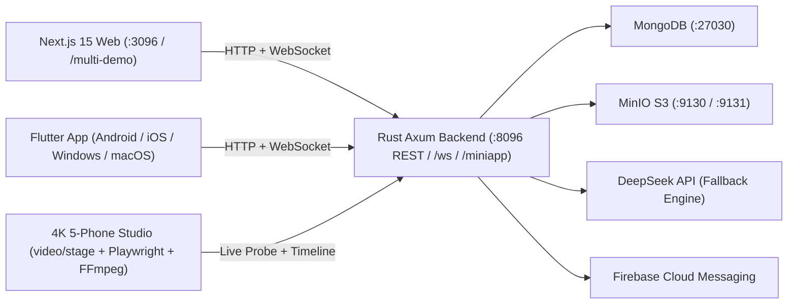

# BC Ai Chat

แอปแชทส่วนตัว ครอบครัว และแก๊งเพื่อนภาษาไทย พร้อมผู้ช่วย AI (`DeepSeek`), คลังรูปภาพและไฟล์ถาวร (`MinIO`), และห้องแชทข้ามแพลตฟอร์ม (`Web`, `Android`, `iOS`, `Windows`, `macOS`) แบบ **Mobile-First ไร้ Popup รบกวน** บนอัตลักษณ์ศิลปะร่วมสมัย **ธีมดินเผาบ้านเชียง (`ban_chiang`)** ปลอดลิขสิทธิ์ 100%


---

## Objective

**BC Ai Chat** พัฒนาขึ้นเพื่อเป็นพื้นที่แชทส่วนตัวสำหรับครอบครัว แก๊งเพื่อนสนิท และเพื่อนบ้านที่ผสานความสามารถของ **DeepSeek AI** เข้ากับคลังเก็บรูปภาพ อัลบั้ม โพลโหวต นัดหมาย และ **สมุดบันทึก BC** ถาวร พร้อมการออกแบบ **Mobile-First 4 แท็บ** ที่เปิดเข้าหน้าแชททันทีและใช้ถาดเครื่องมือแบบ Inline ภายในหน้าจอเดียวโดยไม่เปิด Popup ซ้อนทับ

- **7 ธีมสีไทยร่วมสมัย + 3 โทนห้องแชท**: ค่าเริ่มต้น **บ้านเชียง (`ban_chiang`: `#812920` / `#FBF9F8`)** พร้อมชุดสี **ไหมทองอำพัน (`silk_amber`)**, **ครามสุโขทัย (`indigo_kram`)**, **หยกสังคโลก (`jade_celadon`)**, **บัวหลวงชมพู (`lotus_rose`)**, **อบเชยเครื่องเทศ (`spice_cinnamon`)** และ **มณีม่วงไทย (`royal_amethyst`)** รวมถึง 3 โทนห้องแชท (`ban_chiang_cream` `#F5EFEA`, `terracotta_night` `#1C1412`, `ivory_white` `#FBF9F8`) ซิงค์สดข้ามทุกหน้าจอผ่าน WebSocket (`theme_changed`)


- **นโยบายทรัพย์สินทางปัญญาปลอดลิขสิทธิ์ 100%**:
  - ออกแบบแบรนด์ **BC Ai Chat**, **สมุดบันทึก BC**, **การ์ดโต้ตอบ (`rich_card`)**, **ข่าวสาร BC Ai Chat** และชุดสติกเกอร์ข้อความต้นฉบับ (*"อารมณ์ดีดินเผาไทย"*) ขึ้นมาใหม่ทั้งหมด โดยไม่ใช้ชื่อแบรนด์ เครื่องหมายการค้า ฟีเจอร์ หรือชุดสีของแพลตฟอร์มแชทภายนอก
  - ตกแต่งพื้นผิวด้วยลวดลายเส้นเกลียวคลื่นประยุกต์ผ่าน CSS/SVG ต้นฉบับ โดยไม่นำภาพถ่ายโบราณวัตถุจากกรมศิลปากรหรือแหล่งภายนอกมาใช้งาน
  - ใช้ฟอนต์เปิด `Prompt` (**SIL OFL**), ไอคอน `lucide-react` (**MIT**) / Material Icons (**Apache-2.0**) และเสียงแจ้งเตือน WAV สังเคราะห์ภายในโปรเจกต์

---

## Workflow



1. **เข้าสู่ระบบ 5 บัญชี Demo หรือบัญชีของคุณ**:
   - **5 บัญชี Demo ส่วนตัว**: `ก้อง (Demo 1)` (`demo1@bcaichat.local`), `แพร (Demo 2)` (`demo2@bcaichat.local`), `บอส (Demo 3)` (`demo3@bcaichat.local`), `มายด์ (Demo 4)` (`demo4@bcaichat.local`), `ต้น (Demo 5)` (`demo5@bcaichat.local`) และบัญชีเจ้าของระบบ `ลุงจืด` (`jead@bcaichat.local`)
   - บน Web App (`http://localhost:3096`) เลือกเข้าสู่ระบบด่วนรายบัญชี หรือเปิด `/multi-demo` และ `?demo=1` ถึง `?demo=5` เพื่อทดสอบแชท 5 จอเชื่อมต่อ WebSocket พร้อมกันแบบเรียลไทม์
   - บน Native App (Flutter) แตะเลือกบัญชีทดสอบในหน้า Login, แก้ไข Server URL แบบ Inline หรือเปิด 5 หน้าต่างข้างกันอัตโนมัติบน Windows ด้วย `--test-login` และ `--test-slot=0..4`


2. **Mobile-First 4 แท็บหลัก & UX แบบไร้ Popup**:
   - แถบนำทางหลัก 4 แท็บ: **เพื่อน/หน้าหลัก** (`0`), **แชท** (`1` — เปิดเข้าหน้านี้เป็นค่าเริ่มต้น), **สมุดบันทึก** (`2`), และ **ตั้งค่า** (`3`) พร้อมแถบโฟลเดอร์เลื่อนแนวนอน 7 หมวด (`ทั้งหมด`, `ส่วนตัว`, `ครอบครัว`, `กลุ่ม`, `ปักหมุด`, `ยังไม่อ่าน`, `เก็บถาวร`)
   - **Web App**: บนหน้าจอมือถือ (`< md`) เข้าห้องแชทแบบเต็มจออัตโนมัติ พร้อมแผงเครื่องมือยืดหดแบบ Inline (`room-side-panel`, `rich-card-inline-tray`, `ai-inline-tray`) ไม่ใช้ Dialog ซ้อนหน้าจอ
   - **Flutter 4 Platforms**: ถาดสติกเกอร์, แนบไฟล์, บริการเสริมส่วนตัว และเครื่องมือ AI แบบ Inline เหนือช่องพิมพ์ พร้อมแถบจัดการข้อความเมื่อแตะค้างและแผงคลังรูป/อัลบั้ม/โพล/นัดหมายในหน้าจอเดียว


3. **แชท 1-1 / แชทกลุ่ม และผู้ช่วย `@ai`**:
   - สื่อสารแบบเรียลไทม์ผ่าน WebSocket (`ws://127.0.0.1:8096/ws`) รองรับข้อความ รูปภาพ ไฟล์ถาวร อัดเสียงไมค์ (`audio`) สติกเกอร์ *"อารมณ์ดีดินเผาไทย"* การ์ดโต้ตอบ (`rich_card`) และเรื่องด่วน
   - ในห้อง `แก๊งเพื่อนสนิท 5 คน + BC AI` (`conv_group_demo5`), `กลุ่มครอบครัว & เพื่อนบ้าน` (`conv_group_family`) หรือแชทตรงกับ `🤖 BC AI ผู้ช่วยส่วนตัว` (`@bc.ai`) สามารถพิมพ์ `@ai`, `@bc.ai`, `/ai` หรือ `บีซีเอไอ` เพื่อให้ AI ช่วยตอบ พร้อมเครื่องมือช่วยเกลาคำพูด คิดคำตอบไว จัดลิสต์ขั้นตอน แปลภาษา และสรุปแชท

4. **คลังถาวร สมุดบันทึก BC และ Mini-Apps ส่วนตัว**:
   - รองรับ **Emoji Reactions** (`👍 ❤️ 😂 😮 😢 🙏`), **โพลโหวต (`Polls`)**, **นัดเจอ & ตอบรับ (`Events / RSVP`)**, **อัลบั้มรูป (`Albums`)**, **โน้ตห้อง (`Notes`)**, เชิญเข้ากลุ่มด้วย `invite_token`, **โหมดข้อความลับส่วนตัว** (`🔒 ความลับส่วนตัว` พร้อมล็อก PIN 4 หลักบน Web) และลบทำลายไฟล์ถาวรบน MinIO (`Hard Recall`)
   - **สมุดบันทึก BC & 5 Mini-Apps ส่วนตัว**: `ผู้ช่วย AI ส่วนตัว` (`/miniapp/ai`), `หารค่าข้าวกับเพื่อน` (`/miniapp/split`), `จัดทริปเที่ยว` (`/miniapp/trip`), `ลิสต์ของฝาก / ช้อปปิ้ง` (`/miniapp/wishlist`) และ `การ์ดชวนนัดเจอ` (`/miniapp/hangout`)

5. **สตูดิโอสร้างวิดีโอสาธิต 4K 5 มือถือ (`video/`)**:
   - `video/live_seed.mjs` เชื่อมต่อ Backend (`:8096`) ตรวจสอบข้อมูลจริงของ 5 บัญชี Demo และห้อง `conv_group_demo5` เพื่อสร้างไฟล์อ้างอิง `video/data/live_reference.json`
   - `video/tts_generate.mjs` อ่านบทพากย์จาก `video/script.json` (29 บรรทัด, 6 ฉาก) สร้างเสียงพากย์ภาษาไทยผ่าน ElevenLabs (`eleven_v4`, `pcm_48000`) และสังเคราะห์เอฟเฟกต์เสียงลง `video/data/voice_master.wav`, `video/data/sfx_master.wav`, `video/data/timeline.json`, `video/output/subtitles_th.srt` และ `video/youtube.md`
   - `video/render_4k.mjs` จำลองหน้าจอ 5 มือถือพร้อมกันใน `video/stage/stage_5phones.html` (ร่วมกับ `stage_engine.js` และ `stage_styles.css`) ผ่าน Playwright ที่ความละเอียด `3840x2160` (`30fps`) แล้วรวมเสียงมาตรฐาน EBU R128 ด้วย FFmpeg ออกเป็น `video/output/bc_ai_chat_5phones_4k.mp4` และภาพปก `video/output/thumbnail_4k.png`

---

## Config

### ตารางพอร์ตบริการ (Ports)

| บริการ | Container / Process | พอร์ต | รายละเอียด |
| :--- | :--- | :--- | :--- |
| **MongoDB** | `bcaichat-mongodb` | `27030` | ฐานข้อมูล `bcaichat` (`127.0.0.1:27030:27017`) |
| **MinIO S3 API** | `bcaichat-minio` | `9130` | Object Storage bucket `bcaichat-storage` (`127.0.0.1:9130:9000`) |
| **MinIO Console** | `bcaichat-minio` | `9131` | หน้าเว็บจัดการ MinIO (`127.0.0.1:9131:9001`) |
| **Rust Backend & WS** | `bcaichat-backend` | `8096` | HTTP API `/api/*`, `/miniapp/*` และ WebSocket `/ws` |
| **Next.js Web App** | `bcaichat-web` | `3096` | Frontend เว็บแอปพลิเคชัน (`http://localhost:3096`) |

### ตารางตัวแปรสภาพแวดล้อม (Environment Variables)

อ้างอิงจาก `.env.example`, `backend/src/config.rs`, `web/`, `frontend/`, `e2e/` และ `video/` (คัดลอก `.env.example` เป็น `.env` แล้วใส่ค่าจริงในเครื่องเท่านั้น — ห้าม commit `.env` หรือ API key ลง Git):

| ตัวแปร | ค่าเริ่มต้น / ตัวอย่าง | หน้าที่ |
| :--- | :--- | :--- |
| `PORT` | `8096` | พอร์ตของ Rust Backend |
| `RUST_LOG` | `info` | ระดับการบันทึก log ของ Backend |
| `MONGODB_URI` | `mongodb://127.0.0.1:27030` | Connection string สำหรับ MongoDB |
| `MONGODB_DB` | `bcaichat` | ชื่อฐานข้อมูลหลักใน MongoDB |
| `MINIO_ENDPOINT` | `http://127.0.0.1:9130` | Endpoint ของ MinIO S3 API |
| `MINIO_ACCESS_KEY` | `bcaichatadmin` | Access key สำหรับ MinIO |
| `MINIO_SECRET_KEY` | `bcaichat_minio_local_dev` | Secret key สำหรับ MinIO (เปลี่ยนค่าเมื่อขึ้นระบบจริง) |
| `MINIO_BUCKET` | `bcaichat-storage` | ชื่อ bucket จัดเก็บไฟล์ถาวร |
| `JWT_SECRET` | *(กำหนดสตริงสุ่ม 64 ตัวอักษรใน `.env`)* | คีย์ลงนาม JWT Token |
| `GOOGLE_CLIENT_ID` | `your-google-oauth-client-id` | ใช้ตรวจสอบ Google OAuth2 ID Token |
| `SUPER_ADMIN_EMAIL` | `jead@bcaichat.local` | อีเมลเจ้าของระบบเริ่มต้น |
| `PUBLIC_BASE_URL` | `http://127.0.0.1:8096` | URL ฐานสำหรับลิงก์ไฟล์และ Mini-App ของ Backend |
| `DEEPSEEK_API_KEY` | *(กำหนดคีย์ส่วนตัวใน `.env`)* | API Key สำหรับเชื่อมต่อ DeepSeek |
| `DEEPSEEK_MODEL` | `deepseek-chat` | ชื่อโมเดล DeepSeek ที่ใช้งาน |
| `DEEPSEEK_BASE_URL` | `https://api.deepseek.com` | Base URL ของ DeepSeek API |
| `FCM_SERVICE_ACCOUNT_FILE` | *(เว้นว่างเพื่อปิด Push)* | พาธไฟล์ Service Account JSON ของ Firebase Cloud Messaging |
| `FCM_API_BASE` | `https://fcm.googleapis.com` | Base URL ของ FCM API |
| `BACKEND_URL` | `http://127.0.0.1:8096` | ปลายทาง rewrite `/api/*` และ `/miniapp/*` ใน `web/next.config.ts` |
| `NEXT_PUBLIC_APP_URL` | `http://localhost:3096` | URL สาธารณะของ Web App (ใช้ใน Metadata และ `sitemap.ts`) |
| `NEXT_PUBLIC_WS_URL` | `ws://127.0.0.1:8096/ws` | URL WebSocket ที่ Web Client เชื่อมต่อ |
| `API_BASE_URL` | *(ส่งผ่าน `--dart-define`)* | Override Server URL สำหรับ Flutter ตอน compile/run |
| `BCAICHAT_API_URL` / `API_URL` / `WEB_URL` | `http://127.0.0.1:8096` / `http://localhost:3096` | ตัวแปรระบุเป้าหมายในสคริปต์ E2E (`e2e/*.mjs`) และ `video/live_seed.mjs` |
| `ELEVENLABS_API_KEY` | *(ตัวเลือก: กำหนดคีย์ส่วนตัวใน `.env`)* | API Key สำหรับสร้างเสียงพากย์ภาษาไทยใน `video/tts_generate.mjs` (ใช้เฉพาะตอนสร้างวิดีโอสาธิต ไม่ใช่คีย์ที่ต้องใช้รันแอปแชท) |

---

## Dependency

| หมวดหมู่ | เครื่องมือ / แพ็กเกจหลัก | รายละเอียดและสัญญาอนุญาต |
| :--- | :--- | :--- |
| **Rust Toolchain** | Rust (`edition 2021`), `axum 0.7`, `tokio 1`, `mongodb 3.1`, `bson 2.13`, `reqwest 0.12`, `jsonwebtoken 9.3` | ใช้รันและคอมไพล์ `backend/` |
| **Node.js 20+** | Node.js >= 20, `next ^15.3.3`, `react ^19.1.0`, `typescript ^5.8.3`, `@tailwindcss/postcss ^4.1.8`, `qrcode ^1.5.4`, `playwright ^1.65.1` | ใช้รัน `web/`, ชุด E2E (`e2e/`) และสตูดิโอ 5 มือถือ (`video/`) |
| **Flutter SDK** | Flutter (`Dart SDK ^3.11.5`), `http`, `web_socket_channel`, `shared_preferences`, `file_picker`, `url_launcher`, `google_fonts`, `qr_flutter`, `flutter_local_notifications`, `audioplayers` | ใช้รันและ build `frontend/` สำหรับ Android, iOS, Windows, macOS |
| **Docker** | Docker Engine + Docker Compose (`mongo:7.0`, `minio/minio:latest`) | รันฐานข้อมูล MongoDB และ MinIO Object Storage |
| **DeepSeek API** | DeepSeek Chat Completions API | ประมวลผลผู้ช่วยส่วนตัว `@ai`, เกลาข้อความ, คิดคำตอบไว, และสรุปแชท |
| **เครื่องมือสร้างวิดีโอ 4K (ตัวเลือก)** | `FFmpeg` / `ffprobe` และ ElevenLabs TTS (`eleven_v4`) | ใช้เฉพาะการเรนเดอร์ `video/tts_generate.mjs` และ `video/render_4k.mjs` |
| **ฟอนต์และไอคอนปลอดลิขสิทธิ์** | ฟอนต์ `Prompt` (**SIL Open Font License - OFL**), `lucide-react` (**MIT License**), Material Icons (**Apache-2.0**), เสียง WAV สังเคราะห์ใน `frontend/assets/sounds/` | ใช้งานได้อย่างถูกต้องตามสัญญาอนุญาตเปิด 100% |

---

## Usage example

### 1. โคลนโปรเจกต์ ตั้งค่า `.env` และเปิด Infrastructure (Docker)

```powershell
git clone https://github.com/jaturapornchai/bcaichat001.git
cd bcaichat001

Copy-Item .env.example .env
# สำหรับ macOS / Linux: cp .env.example .env
# แก้ไข JWT_SECRET และ DEEPSEEK_API_KEY ใน .env ด้วยค่าส่วนตัวของคุณ

docker compose up -d
docker compose ps
```

### 2. เปิด Rust Backend (`:8096`)

```powershell
# จากโฟลเดอร์ root ของโปรเจกต์ (bcaichat)
cd backend
cargo run
```

ตรวจสอบสถานะระบบและธีมเริ่มต้น (จากอีกเทอร์มินัล):

```powershell
curl http://127.0.0.1:8096/api/health
curl http://127.0.0.1:8096/api/settings/theme
```

### 3. เปิด Next.js Web App (`:3096`)

```powershell
# จากโฟลเดอร์ root ของโปรเจกต์ (bcaichat)
cd web
npm install
npm run dev
```

เข้าใช้งานได้ที่ `http://localhost:3096` หรือเปิดโหมดทดสอบ 5 บัญชีพร้อมกันในหน้าเดียวที่ `http://localhost:3096/multi-demo` และล็อกอินด่วนรายแท็บผ่าน `http://localhost:3096/?demo=1` ถึง `?demo=5`

### 4. รันและ Build Flutter ทั้ง 4 แพลตฟอร์ม (`com.bcaichat.app`)

```powershell
# จากโฟลเดอร์ root ของโปรเจกต์ (bcaichat)
cd frontend
flutter pub get

# Android (เชื่อมต่อไปที่ http://10.0.2.2:8096 โดยอัตโนมัติ หรือระบุ IP เครื่องจริง)
flutter run -d android
flutter build apk --release

# Windows Desktop (ได้ไฟล์ build/windows/x64/runner/Release/bcaichat.exe)
flutter build windows --release
# ตัวอย่างเปิดทดสอบหน้าต่างแยกบัญชีบน Windows
.\build\windows\x64\runner\Release\bcaichat.exe --test-login=demo1@bcaichat.local --test-slot=0

# macOS (รันบนเครื่อง macOS)
flutter build macos --release

# iOS (รันบนเครื่อง macOS หรือผ่าน .github/workflows/build-apple.yml)
flutter build ios --release --no-codesign
```

หากต้องการกำหนด URL ของ Backend ตอนรัน/Build Flutter สามารถส่ง `--dart-define=API_BASE_URL=http://<server-ip>:8096` หรือแก้ไข Server URL แบบ Inline บนหน้า Login ได้ทันที

### 5. รันชุดทดสอบ 5 บัญชี Demo และ E2E ทั้งระบบ

```powershell
# ทดสอบ Rust Backend (Unit & Integration Tests)
cd backend
cargo test
cd ..

# ทดสอบ E2E API + WebSocket + AI + MinIO ครบ 5 บัญชี Demo (ต้องเปิด Docker + Backend :8096 ก่อน)
node e2e/e2e_api_ws_5users.mjs

# ตรวจสอบ TypeScript และ Production Build ของ Web App
cd web
npx tsc --noEmit
npm run build
cd ..

# ทดสอบ E2E 5 จอ Chromium พร้อมกันและ Mobile Viewport 390x844 (ต้องเปิด Backend :8096 + Web :3096 ก่อน)
node e2e/e2e_playwright_web_5users.mjs

# ตรวจสอบคุณภาพโค้ดและชุดทดสอบของ Flutter (รวม Live Dart E2E เมื่อ Backend :8096 เปิดอยู่)
cd frontend
flutter analyze
flutter test
flutter test test_e2e/live_backend_e2e_test.dart
```

### 6. สร้างวิดีโอสาธิต 4K 5 มือถือ (`video/`) *(ตัวเลือก)*

```powershell
# จากโฟลเดอร์ root ของโปรเจกต์ (bcaichat) และติดตั้ง ffmpeg + ตั้ง ELEVENLABS_API_KEY ใน .env
# 1) ตรวจสอบ API/ห้องแชทจริงเพื่อบันทึกข้อมูลอ้างอิงลง video/data/live_reference.json
node video/live_seed.mjs

# 2) สร้างเสียงพากย์ไทย (ElevenLabs eleven_v4) + เสียงเอฟเฟกต์ + timeline.json + คำบรรยาย SRT
node video/tts_generate.mjs

# 3) ทดสอบเรนเดอร์ด่วน 3 วินาที (Smoke Check)
node video/render_4k.mjs --smoke

# 4) เรนเดอร์วิดีโอ 4K เต็ม (3840x2160 @ 30fps) พร้อมภาพปก 4K
node video/render_4k.mjs --workers=4

# ตัวเลือกเสริม: สร้างเฉพาะภาพปก หรือเก็บไฟล์เฟรมชั่วคราวไว้ตรวจสอบ
node video/render_4k.mjs --thumbnail-only
node video/render_4k.mjs --workers=4 --keep-segments
```

---

## Limitation

- **Demo Login Mode (`backend/src/routes/auth_routes.rs`)**: เพื่อความสะดวกในการทดสอบ 5 บัญชี Demo (`demo1..5@bcaichat.local`) และบัญชีเจ้าของระบบภายในเครื่อง ระบบอนุญาตให้เข้าสู่ระบบเมื่อ `id_token` ว่างหรือขึ้นต้นด้วย `demo_` การนำไปใช้งาน Production จริงต้องบังคับตรวจสอบ Google OAuth2 ID Token ทุกคำขอ
- **การเชื่อมต่อ Android อุปกรณ์จริง**: ค่าเริ่มต้นบน Android ชี้ที่ `http://10.0.2.2:8096` สำหรับ Android Emulator หากใช้งานบนอุปกรณ์จริงต้องระบุ IP ของเครื่องเซิร์ฟเวอร์ผ่านส่วนแก้ไข Server URL บนหน้า Login หรือ `--dart-define=API_BASE_URL=...`
- **การ Build สำหรับ Apple (iOS / macOS)**: ไม่สามารถ Build บน Windows ได้โดยตรง ต้องดำเนินการบนเครื่อง macOS หรือสั่งรัน GitHub Actions workflow `.github/workflows/build-apple.yml` (`workflow_dispatch`)
- **Push Notification (FCM)**: ถูกปิดเป็นค่าเริ่มต้นหากยังไม่ได้ระบุพาธไฟล์ใน `FCM_SERVICE_ACCOUNT_FILE`
- **DeepSeek AI Fallback**: หากยังไม่ตั้งค่า `DEEPSEEK_API_KEY` ที่ใช้งานได้ ผู้ช่วย `@ai` จะตอบกลับด้วย fallback engine ภายใน (`generate_smart_context_reply`) แทนการเรียกโมเดล DeepSeek บนคลาวด์
- **เครื่องมือสร้างวิดีโอ 4K (`video/`)**: การสังเคราะห์เสียงพากย์ใหม่ใน `video/tts_generate.mjs` ต้องใช้ `ELEVENLABS_API_KEY` และขั้นตอน `video/render_4k.mjs` ต้องติดตั้ง `FFmpeg` / `ffprobe` รวมถึง Dependency ของ Playwright ใน `web/node_modules/`
